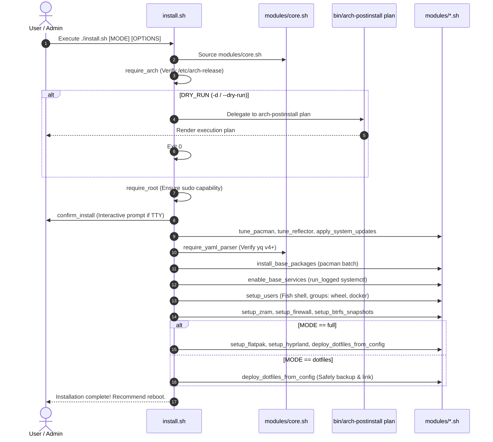
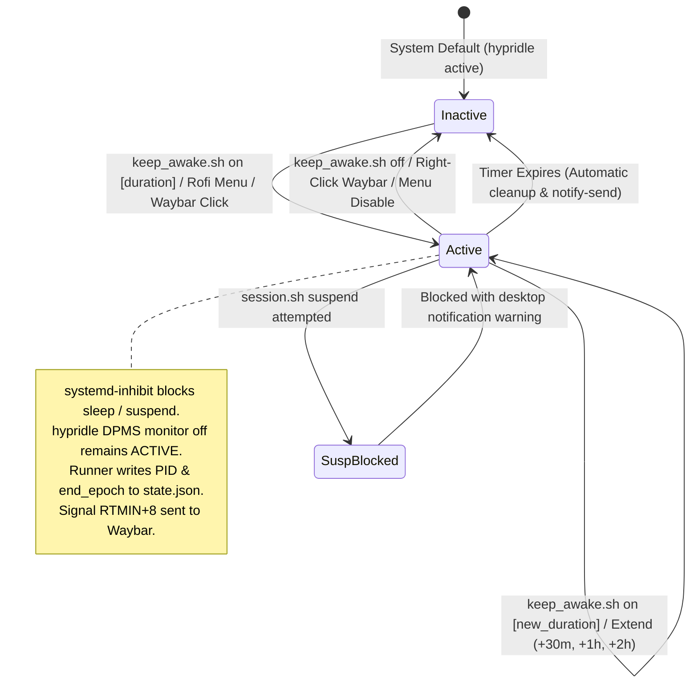
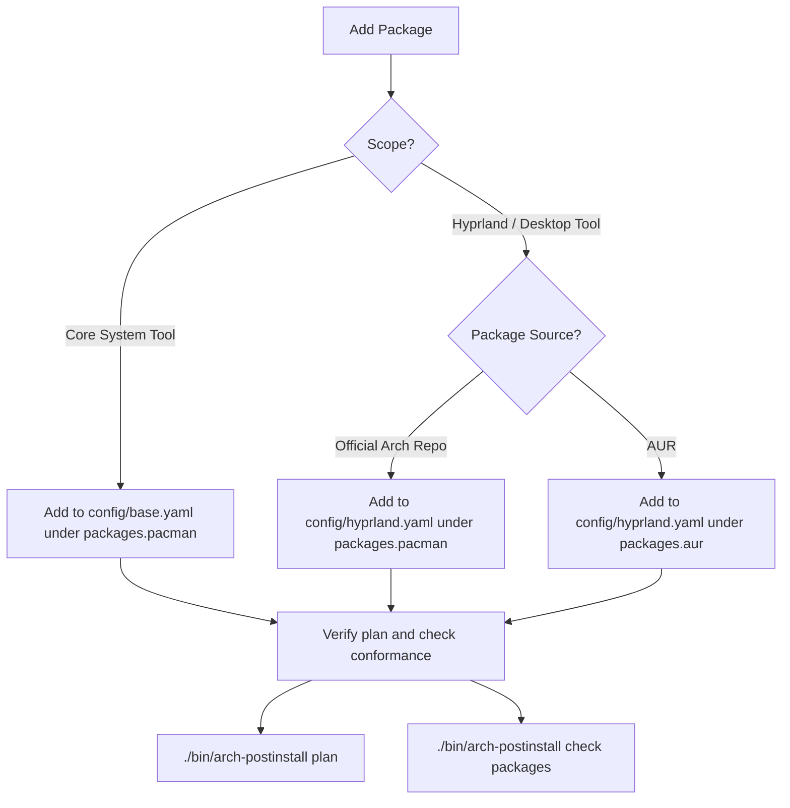

# Arch Linux Post-Installation Workbench — Comprehensive Knowledge Base (KB)

> **Document Version:** 2.2.0  
> **Target Environment:** Arch Linux (x86_64), Wayland / Hyprland 0.55+ (Lua Engine)  
> **Audience:** Core Developers, DevOps Engineers, System Integrators, and Autonomous AI Agents  
> **Status:** Authoritative / Canonical Technical Architecture Reference

---

## Table of Contents

1. [Executive Summary & Core Philosophy](#1-executive-summary--core-philosophy)
2. [Dual-Engine Architecture & System Topography](#2-dual-engine-architecture--system-topography)
3. [Directory & Component Inventory](#3-directory--component-inventory)
4. [Execution Lifecycles & State Transitions](#4-execution-lifecycles--state-transitions)
5. [Protocols, Data Contracts & Security Models](#5-protocols-data-contracts--security-models)
6. [Developer & AI Assistant Operational Playbooks](#6-developer--ai-assistant-operational-playbooks)
7. [Testing, Linting & CI/CD Verification Guardrails](#7-testing-linting--cicd-verification-guardrails)
8. [Gotchas, Invariants & Defect Backlog Index](#8-gotchas-invariants--defect-backlog-index)

---

## 1. Executive Summary & Core Philosophy

The **Arch Linux Post-Installation Workbench** is an automated, declarative framework that transforms a freshly installed minimal Arch Linux installation into a hardened, production-grade workstation powered by **Hyprland** (native Lua configuration engine), Waybar, SwayNC, and a centralized theming subsystem.

Unlike conventional shell setup scripts that execute unstructured shell commands imperatively, this repository decouples system state into **two completely independent execution engines**:
1. **The Mutating Provisioner (`install.sh` + `modules/`)**: Mutates operating system state to match declarative specifications.
2. **The Read-Only Validator & Diagnostics Engine (`bin/arch-postinstall` + `lib/` + `scripts/check/`)**: Formulates dry-run execution plans, evaluates compliance against declared YAML configurations, assesses runtime health, and prescribes safe root-cause remediations.

### Architectural Invariants & Tenets

- **Bash-Only Runtime**: No secondary build tools, compilers, or package managers (e.g., Python, Node, Cargo) are required to execute or test the framework. Everything runs natively under GNU `bash` (v5+).
- **Declarative Source of Truth**: All target packages, systemd services, filesystem mountpoints, user groups, and symlinked configuration directories are declared in human-readable YAML documents (`config/base.yaml`, `config/hyprland.yaml`, `config/user.yaml`).
- **Hard Dependency on `yq`**: Configuration is parsed strictly via the Go implementation of `yq` (v4+). There is **no fallback regex/grep parser** — earlier grep-based fallbacks failed silently on nested keys. Missing parser invocations abort immediately with exit code `4`.
- **Fail-Loud Philosophy**: The engine explicitly rejects silent failures. Commands are wrapped with `run_logged` to preserve pipeline exit codes independent of `pipefail`, and state checks verify actual system state rather than assuming command success.
- **Fail-Safe Symlinking**: Existing files, directories, or legacy symlinks in `~/.config/` are automatically backed up to a timestamped archive (`~/.config-backup-<timestamp>/`) prior to symlink creation.
- **Strict Separation of Privileges**: Validation, health inspection, dry-run planning, and dotfile deployment run entirely in unprivileged user space. Elevated permissions (`sudo`) are requested only when mutation of root-owned subsystems is strictly necessary.
- **Strictly Sanitized Remediations**: Remediation commands suggested by the diagnostic engine are vetted against a strict security allowlist (`fix_cmd_is_safe`) before execution under `sudo`.

---

## 2. Dual-Engine Architecture & System Topography

The codebase is organized into three primary architectural pillars:

```mermaid
flowchart TD
    subgraph ConfigLayer ["Configuration Layer (Declarative State)"]
        BaseYAML["config/base.yaml\n(Core Packages, Services, Groups, Timezone)"]
        HyprYAML["config/hyprland.yaml\n(Desktop Packages, Dual-Bus Services, Dotfiles)"]
        UserYAML["config/user.yaml\n(User Keybind Overrides & Preferences)"]
        ChecksConf["config/checks.conf\n(Health Thresholds & Ping Targets)"]
    end

    subgraph MutatingEngine ["Engine A: Mutating Provisioner (install.sh)"]
        Installer["install.sh\n(Entry & Mode Dispatcher)"]
        CoreMod["modules/core.sh\n(Logging, run_logged, yq wrappers)"]
        SysMod["modules/system.sh\n(Pacman, Reflector, UFW, ZRAM)"]
        PkgMod["modules/packages.sh\n(Pacman & AUR via yay)"]
        SvcMod["modules/services.sh\n(Systemd enable/start)"]
        UsrMod["modules/users.sh\n(Shell, Wheel, Groups)"]
        DotMod["modules/dotfiles.sh\n(Symlinks with Safe Backup)"]
        BtrfsMod["modules/btrfs.sh\n(Snapper Snapshots)"]
        FlatMod["modules/flatpak.sh\n(Flathub Runtimes)"]
        ProfHypr["profiles/hyprland.sh\n(Profile Hook)"]
        
        Installer --> CoreMod
        Installer --> SysMod & PkgMod & SvcMod & UsrMod & DotMod & BtrfsMod & FlatMod & ProfHypr
    end

    subgraph ReadOnlyEngine ["Engine B: Read-Only Validator & Planner (bin/arch-postinstall)"]
        CLI["bin/arch-postinstall\n(Unified Entry: check | health | doctor | fix | plan)"]
        LibCommon["lib/common.sh\n(Introspection & YAML accessors)"]
        LibChecks["lib/checks.sh\n(Accumulator & 7-Arg Assertion API)"]
        LibDoctor["lib/doctor.sh\n(Diagnosis & Safe Fix Dispatcher)"]
        LibPlanner["lib/planner.sh\n(Dry-Run Discovery & Risk Analysis)"]
        LibOutput["lib/output.sh\n(Scorecards & TTY formatting)"]
        CheckCats["scripts/check/*.sh\n(14 Modular Verification Categories)"]
        
        CLI --> LibCommon & LibChecks & LibDoctor & LibPlanner & LibOutput
        CLI --> CheckCats
    end

    subgraph DesktopRuntime ["Desktop Subsystem (Hyprland Lua Engine)"]
        HyprLua["dotfiles/hypr/hyprland.lua\n(Compositor Entrypoint)"]
        HyprConfig["dotfiles/hypr/config/*.lua\n(Monitors, Look&Feel, Rules, Keybinds)"]
        ThemeEngine["dotfiles/hypr/scripts/toggle_theme.sh\n(8 Dual-Mode Palette Synchronizer)"]
        AwakeEngine["dotfiles/hypr/scripts/keep_awake.sh\n(Sleep Inhibition Engine)"]
        WaybarCfg["dotfiles/waybar/config.jsonc\n(Status Bar & Custom Modules)"]
        SwayNCCfg["dotfiles/swaync/config.json\n(Notification Center & Tools)"]
        
        HyprLua --> HyprConfig
        ThemeEngine --> HyprLua & WaybarCfg & SwayNCCfg
    end

    ConfigLayer --> MutatingEngine
    ConfigLayer --> ReadOnlyEngine
    MutatingEngine -.->|Deploys to ~/.config| DesktopRuntime
    Installer -.->|"--dry-run delegates"| LibPlanner
```



### Engine Responsibilities Matrix

| Attribute | Mutating Provisioner | Read-Only Validator / Planner |
|---|---|---|
| **Entry Point** | `install.sh` | `bin/arch-postinstall` |
| **Source Libraries** | `modules/*.sh`, `profiles/*.sh` | `lib/*.sh`, `scripts/check/*.sh` |
| **Privilege Requirement** | Requires root (`sudo`) after mode selection | Root NOT required; degrades gracefully |
| **Config Sources** | `config/base.yaml`, `config/hyprland.yaml` | `config/*.yaml`, `config/checks.conf` |
| **Execution Modes** | `full`, `base`, `dotfiles` | `check`, `health`, `doctor`, `fix`, `plan`, `status` |
| **Dry-Run Mechanism** | Delegates directly to `arch-postinstall plan` | Self-contained discovery engine (`lib/planner.sh`) |
| **Idempotency Goal** | Conditional checks before applying changes | Read-only; zero mutation |

---

## 3. Directory & Component Inventory

```
arch-post-install/
├── bin/
│   └── arch-postinstall            # Unified CLI entry point for validation and diagnostics
├── config/
│   ├── base.yaml                   # Core packages, services, user groups, system settings
│   ├── checks.conf                 # Runtime thresholds (disk %, inodes %, memory %, timeouts)
│   ├── hyprland.yaml               # Desktop packages, AUR dependencies, dotfiles list
│   └── user.yaml                   # User-specific keybinding overrides and theme preferences
├── docs/
│   ├── check-framework.md          # Architectural guide for check categories
│   ├── roadmap.md                  # Development trajectory and planned expansions
│   └── KNOWLEDGE_BASE.md           # This document (authoritative technical guide)
├── dotfiles/                       # 18 Modular user configurations deployed to ~/.config/
│   ├── alacritty/                  # Alacritty terminal emulator configuration & themes
│   ├── calcure/                    # Terminal calendar and task manager
│   ├── clipse/                     # Wayland clipboard history daemon configuration
│   ├── fastfetch/                  # Fast system fetch display configuration
│   ├── fish/                       # Interactive Fish shell configuration & functions
│   ├── gtk/                        # GTK 2.0 / 3.0 / 4.0 settings & bookmark assets
│   ├── hypr/                       # Hyprland 0.55+ Lua configuration, scripts, and themes
│   ├── kitty/                      # Primary Kitty GPU-accelerated terminal configuration
│   ├── kvantum/                    # Qt theme engine configuration
│   ├── nvim/                       # Neovim IDE configuration (LazyVim distribution)
│   ├── ohmyposh/                   # Prompt themes for shell environments
│   ├── rofi/                       # Rofi application launcher and quick-settings themes
│   ├── superfile/                  # Modern terminal file manager
│   ├── swaync/                     # SwayNotificationCenter configuration & styling
│   ├── theme/                      # Global theme state descriptors
│   ├── tui-journal/                # Terminal journaling and notes application
│   ├── waybar/                     # Waybar top-bar configuration, style, and helper scripts
│   ├── yazi/                       # Blazing-fast terminal file manager with image previews
│   └── zellij/                     # Terminal workspace multiplexer configuration
├── lib/
│   ├── checks.sh                   # Check registry, accumulator, allowlist validator, JSON engine
│   ├── common.sh                   # System introspection, yq parser wrappers, probe helpers
│   ├── doctor.sh                   # Root-cause diagnostic generator and interactive fixer
│   ├── output.sh                   # TTY formatting, colors, symbols, and visual scorecards
│   └── planner.sh                  # Dry-run execution engine with desired-vs-current risk analysis
├── modules/
│   ├── btrfs.sh                    # Snapper automated snapshots, subvolume configuration
│   ├── core.sh                     # Core logging (log_step, log_success), run_logged, yq helpers
│   ├── dotfiles.sh                 # Dotfile backup and symlink deployment engine
│   ├── flatpak.sh                  # Flatpak runtime and application installation
│   ├── packages.sh                 # Batch pacman and AUR installation via yay
│   ├── services.sh                 # Systemd system/user service enablement engine
│   ├── system.sh                   # Kernel tuning, pacman.conf, UFW firewall, ZRAM swap
│   └── users.sh                    # User creation, groups (wheel, docker), shell configuration
├── profiles/
│   └── hyprland.sh                 # Desktop profile integration module
├── scripts/
│   ├── check/                      # 14 Modular check categories (check_* and health_*)
│   │   ├── audio.sh                # PipeWire, WirePlumber, audio sinks
│   │   ├── base.sh                 # OS release, hostname, timezone, locale, microcode
│   │   ├── bluetooth.sh            # BlueZ service, controller, rfkill state
│   │   ├── boot.sh                 # EFI system partition, bootloader, initramfs sync
│   │   ├── desktop.sh              # Hyprland session, Wayland environment, portals, dotfiles
│   │   ├── filesystem.sh           # Mountpoints, disk capacity %, inode %, read-only checks
│   │   ├── hardware.sh             # CPU topology, RAM/swap utilization, GPU drivers
│   │   ├── maintenance.sh          # Package updates, orphan hygiene, journal sizes
│   │   ├── network.sh              # Interfaces, IP addresses, default gateway, DNS, ping
│   │   ├── packages.sh             # Pacman DB lock, YAML package conformance, update checks
│   │   ├── power.sh                # Chassis detection, battery health, thermal status
│   │   ├── security.sh             # UID 0 checks, wheel members, SSH posture, UFW firewall
│   │   ├── systemd.sh              # Failed units, system state, declarative service conformance
│   │   └── time.sh                 # Clock synchronization, timezone conformance, NTP status
│   ├── fonts.sh                    # Font cache generator helper
│   ├── install_yay.sh              # Automated yay AUR helper bootstrapping
│   ├── setup_fish.sh               # Fish shell configuration bootstrap
│   ├── setup_kwallet.sh            # PAM KWallet automated unlock configuration
│   └── setup_waybar_media.sh       # Waybar media widget script installer
├── tests/
│   ├── lint_check_slots.sh         # Static AST linter for check script 7-argument signatures
│   ├── test_categories.sh          # End-to-end category runner test
│   ├── test_cli.sh                 # CLI flags, help, version, and exit-code validation
│   ├── test_framework.sh           # Unit tests for assertion counters and accumulator
│   ├── test_json.sh                # JSON schema validity and jq-compliance verification
│   ├── test_plan.sh                # Declarative dry-run planner comprehensive test suite
│   ├── test_regressions.sh         # Unit regression test suite (95+ locked assertions)
│   └── test_runner.sh              # Test suite orchestrator
├── AGENTS.md                       # Strict guidelines and invariants for AI agents
├── ARCHITECTURE.md                 # System architecture overview
├── CHANGELOG.md                    # Keep-a-Changelog dated development history
├── CONTRIBUTING.md                 # Contribution guidelines and coding conventions
├── IMPROVEMENTS.md                 # Defect backlog and known issue tracking
├── install.sh                      # Interactive/non-interactive mutating installation entrypoint
├── Makefile                        # Unified task runner and development shortcuts
└── README.md                       # User-facing repository overview and setup guide
```

---

## 4. Execution Lifecycles & State Transitions

### Lifecycle 1: Mutating Installation Flow (`install.sh`)



### Lifecycle 2: Validation, Health & Diagnostics (`arch-postinstall`)

```mermaid
flowchart TD
    Start([Execute: arch-postinstall &lt;cmd&gt; [categories] [options]]) --> ParseArgs[Parse CLI Flags & Options]
    ParseArgs --> RequireYQ{yq present?}
    RequireYQ -- No --> Exit4[Exit 4: Missing Dependency Hint]
    RequireYQ -- Yes --> Dispatch{Command}

    Dispatch -- check --> RunCheck[Execute check_&lt;cat&gt; on selected categories]
    Dispatch -- health --> RunHealth[Execute health_&lt;cat&gt; on selected categories]
    Dispatch -- status --> RunBoth[Execute check_&lt;cat&gt; AND health_&lt;cat&gt;]
    Dispatch -- doctor / fix --> RunDiag[Execute check_&lt;cat&gt; + health_&lt;cat&gt;]
    Dispatch -- plan --> RunPlan[Execute lib/planner.sh State Discovery]

    RunCheck & RunHealth & RunBoth --> Accumulate[Accumulate results in CHECKS_RESULTS array]
    Accumulate --> OutputFmt{JSON mode?}
    OutputFmt -- Yes --> RenderJSON[Serialize via jq to standard JSON schema]
    OutputFmt -- No --> RenderTTY[Format ANSI scorecards & summary banner]

    RunDiag --> DocAnalyze[lib/doctor.sh: Filter FAIL and WARN records]
    DocAnalyze --> FormatFix[Format Expected vs Current & suggested_fix]
    FormatFix --> IsFixMode{--fix or fix cmd?}
    IsFixMode -- No --> ExitDoc[Output findings & Exit code]
    IsFixMode -- Yes --> PromptFix[Iterate fixes: prompt user unless -y]
    PromptFix --> ValidateFix{fix_cmd_is_safe?}
    ValidateFix -- No --> RefuseFix[Report Refusal: Refuse unsafe command]
    ValidateFix -- Yes --> EvalFix[eval under sudo]
    EvalFix --> ExitDoc

    RunPlan --> PlanDiscovery[Probe pacman, AUR, units, mountpoints, symlinks]
    PlanDiscovery --> RiskEval[Classify operations: safe / caution / destructive]
    RiskEval --> RenderPlan[Output Plan Summary & Operation Records]
```

### Lifecycle 3: Sleep Inhibition State Machine (`keep_awake.sh`)



---

## 5. Protocols, Data Contracts & Security Models

### The 7-Argument Check Assertion Contract

Every check and health verification function in `scripts/check/*.sh` reports findings using standard assertion helpers defined in `lib/checks.sh`:

```bash
pass <category> <name> <message>
info <category> <name> <message>
skip <category> <name> <message>
warn <category> <name> <message> <details> <fix_cmd> <expected> <current>
fail <category> <name> <message> <details> <fix_cmd> <expected> <current>
```

#### Signature Specification

| Position | Parameter | Type | Required | Description |
|:---:|---|---|:---:|---|
| **$1** | `category` | string | Yes | Lowercase category name (e.g., `"base"`, `"security"`, `"desktop"`) |
| **$2** | `name` | string | Yes | Snake_case check identifier (e.g., `"ufw_status"`, `"kernel_version"`) |
| **$3** | `message` | string | Yes | Concise human-readable summary of status |
| **$4** | `details` | string | No | Deep diagnostic context, logs, or error reason (MUST NOT contain executable fixes) |
| **$5** | `fix_cmd` | string | No | Single-line executable shell remediation (MUST comply with `fix_cmd_is_safe`) |
| **$6** | `expected` | string | No | Declarative expected value (e.g., `"enabled"`, `"80%"`, `"active"`) |
| **$7** | `current` | string | No | Live runtime inspected value (e.g., `"disabled"`, `"96%"`, `"inactive"`) |

> [!CAUTION]
> **Positional Slot Trap:** Passing a remediation string in argument 4 (`details`) leaves `fix_cmd` empty. This silently drops the remediation from JSON output and prevents `doctor --fix` from remediating the defect. The static linter `tests/lint_check_slots.sh` guarantees signature conformance during testing.

### Record Protocol: ASCII Unit Separator (`\x1f`) Schema

Internal check records are stored in the global Bash array `CHECKS_RESULTS`. To prevent record corruption from pipelines, semicolons, and arbitrary prose, fields are delimited by `CHECK_FIELD_SEP=$'\x1f'` (ASCII Unit Separator, 31 decimal):

```
Record Format:
<cat>\x1f<name>\x1f<status>\x1f<message>\x1f<details>\x1f<fix_cmd>\x1f<expected>\x1f<current>
```

Parsing pattern across readers:
```bash
IFS="${CHECK_FIELD_SEP}" read -r cat name status msg details fix exp cur <<< "${record}"
```

### Remediation Security Model (`fix_cmd_is_safe`)

Remediations executed by `arch-postinstall fix` or `doctor --fix` run under `sudo`. To eliminate command injection vulnerabilities from configuration files, every remediation string is validated against an allowlist before `eval`:

```mermaid
flowchart LR
    FixString[Remediation String] --> CheckMetachars{Contains forbidden chars?<br>` ; &lt; &gt; $ \n}
    CheckMetachars -- Yes --> Deny[Reject: Unsafe Metacharacter]
    CheckMetachars -- No --> CheckQuotes{Balanced quotes?}
    CheckQuotes -- No --> Deny
    CheckQuotes -- Yes --> SplitPipes[Tokenize segments by &amp;&amp;, ||, |]
    SplitPipes --> CheckBinary{First command of each segment in FIX_CMD_ALLOWED_CMDS?}
    CheckBinary -- No --> Deny
    CheckBinary -- Yes --> Approve[Approve for execution under eval]
```

`FIX_CMD_ALLOWED_CMDS` contains ~55 vetted binaries, including:
`pacman`, `yay`, `systemctl`, `hostnamectl`, `timedatectl`, `localectl`, `ufw`, `btrfs`, `snapper`, `chmod`, `chown`, `mkdir`, `tee`, `xargs`, `sed`, `install.sh`.

### JSON Schema Contract (`--json`)

When invoked with `--json`, `arch-postinstall` outputs a machine-readable payload validated against standard schema expectations:

```json
{
  "schema_version": "1.0.0",
  "generated_at": "2026-11-12T10:15:25+05:30",
  "command": "check",
  "profile": "hyprland",
  "summary": {
    "total": 42,
    "passed": 38,
    "warnings": 3,
    "failures": 1,
    "skipped": 0,
    "score_percent": 90
  },
  "results": [
    {
      "category": "security",
      "name": "ufw_status",
      "status": "FAIL",
      "message": "UFW firewall is inactive",
      "details": "Incoming network traffic is unrestricted",
      "suggested_fix": "sudo ufw default deny incoming && sudo ufw enable",
      "expected": "active",
      "current": "inactive"
    }
  ]
}
```

---

## 6. Developer & AI Assistant Operational Playbooks

### Playbook A: Adding a New Package



### Playbook B: Adding a New Check Category

To add a new verification category (e.g., `virtualization`), follow this exact 2-step procedure:

1. **Create Verification Script (`scripts/check/virtualization.sh`)**:
   The module must define **both** `check_<category>()` and `health_<category>()`:
   ```bash
   #!/usr/bin/env bash
   # Category: virtualization.sh

   check_virtualization() {
       print_category_header "Virtualization Configuration"
       if package_installed "qemu-desktop"; then
           pass "virtualization" "qemu_pkg" "QEMU package installed"
       else
           warn "virtualization" "qemu_pkg" "QEMU not installed" \
                "KVM virtualization requires qemu" "sudo pacman -S qemu-desktop" \
                "installed" "missing"
       fi
   }

   health_virtualization() {
       print_category_header "Virtualization Runtime Health"
       if [[ -e /dev/kvm ]]; then
           pass "virtualization" "kvm_device" "KVM hardware acceleration available (/dev/kvm)"
       else
           warn "virtualization" "kvm_device" "KVM device node missing" \
                "Check BIOS/UEFI virtualization settings (VT-x/AMD-V)" "" \
                "present" "missing"
       fi
   }
   ```

2. **Register in `bin/arch-postinstall`**:
   Add `"virtualization"` to the `ALL_CATEGORIES` array in `bin/arch-postinstall` (line ~60):
   ```bash
   ALL_CATEGORIES=(
       ...
       "power"
       "maintenance"
       "virtualization"
   )
   ```

> [!IMPORTANT]
> Check scripts under `scripts/check/` are auto-globbed for sourcing, but **unregistered categories in `ALL_CATEGORIES` remain completely unreachable** via CLI commands like `check`, `health`, and `doctor`.

### Playbook C: Adding a New Dotfile Directory

1. Place your configuration directory under `dotfiles/<dirname>/` (e.g., `dotfiles/btop/`).
2. Add `<dirname>` to the `dotfiles:` array in `config/hyprland.yaml`:
   ```yaml
   dotfiles:
     - hypr
     - waybar
     - btop   # <-- Added
   ```
3. Test deployment preview:
   ```bash
   ./bin/arch-postinstall plan
   ```
4. Deploy:
   ```bash
   ./install.sh dotfiles
   ```

### Playbook D: Adding or Overriding Keybindings

Hyprland uses a modular Lua configuration system. Keybindings are separated by role under `dotfiles/hypr/config/keybinds/`:
- `core.lua`: Workspaces, window tiling, focus navigation, standard application launchers.
- `media.lua`: Volume, brightness, playback controls.
- `utilities.lua`: Screenshots, screen recording, OCR, power menu, Keep Awake.
- `personal.lua`: Calculator, notes, TUI hubs.

To add a binding in Lua:
```lua
hl.bind(mainMod .. " + ALT + W", hl.dsp.exec_cmd("~/.config/hypr/scripts/my_script.sh"))
```

To provide user-customizable overrides in `config/user.yaml`:
1. Add key under `keybindings` in `config/user.yaml`:
   ```yaml
   keybindings:
     my_action: "SUPER + ALT + W"
   ```
2. Map action command in `dotfiles/hypr/scripts/generate_user_bindings.sh`:
   ```bash
   declare -A ACTION_CMDS=(
       ...
       [my_action]="$HOME/.config/hypr/scripts/my_script.sh"
   )
   ```
3. Regenerate overrides:
   ```bash
   bash dotfiles/hypr/scripts/generate_user_bindings.sh
   ```

---

## 7. Testing, Linting & CI/CD Verification Guardrails

### Test Suite Map

```
tests/test_runner.sh (Master Orchestrator)
├── test_regressions.sh  # Unit regression suite (95+ assertions; ~1.5s runtime)
├── test_framework.sh    # Accumulator state, counters, reset logic
├── test_cli.sh          # Argument parsing, flags, help, exit-code contract
├── test_json.sh         # JSON schema conformance & jq parseability
├── test_categories.sh   # Live check category invocation & exit validation
└── test_plan.sh         # Desired-vs-current discovery, idempotency, risk levels
```

### Specialized Linter: `tests/lint_check_slots.sh`

The repository includes a static analysis AST parser written specifically for the check engine. It validates:
- **Rule A (Details Slot)**: Confirms no remediation command is accidentally passed in the `details` slot (argument 4).
- **Rule B (Fix Slot)**: Verifies that the string in `fix_cmd` (argument 5) represents a valid executable shell command shape adhering to `FIX_CMD_ALLOWED_CMDS`. It rejects explanatory prose (e.g., `"Inspect /etc/passwd"`) which would fail at runtime.

Run the linter manually:
```bash
bash tests/lint_check_slots.sh
```

### ShellCheck & CI Behavior

- Local `make lint` runs `shellcheck ... 2>/dev/null || echo "shellcheck not installed."`. Therefore, **local `make lint` does not fail when ShellCheck is absent**.
- GitHub Actions CI (`.github/workflows/lint.yml` using `ludeeus/action-shellcheck`) is the authoritative enforcement gate. Always verify bash scripts manually before committing:
  ```bash
  bash -n scripts/check/*.sh lib/*.sh modules/*.sh dotfiles/hypr/scripts/*.sh
  ```

---

## 8. Gotchas, Invariants & Defect Backlog Index

### Critical Shell Pitfalls

1. **`if cmd | tee -a "$LOG"; then` without pipefail**:
   Without `set -o pipefail`, the exit code evaluated by `if` is that of `tee` (which almost always succeeds), swallowing command failures.
   **Solution**: Always use the `run_logged` helper from `modules/core.sh`:
   ```bash
   run_logged "sudo pacman -S --noconfirm pkg" || log_warn "Package install failed"
   ```

2. **No Command Substitution in Remediations**:
   The `fix_cmd_is_safe` allowlist completely forbids `$`, backticks, and subshells.
   - **Invalid**: `"pacman -Rns $(pacman -Qdtq)"`
   - **Valid**: `"pacman -Qdtq | xargs -r sudo pacman -Rns --noconfirm"`

3. **Dual-Bus Systemd Services**:
   Services like `pipewire`, `wireplumber`, and `dunst` run on the **user bus** (`systemctl --user`), not the system bus. Enabling user units requires an active user manager or `loginctl enable-linger <user>`.

4. **Hard Dependency on `yq` (Go Version)**:
   Ensure `yq` is installed (`pacman -S yq`). Python's `yq` has different command-line syntax and is incompatible with the Go `yq` expressions used throughout the engine.

### Defect Backlog (`IMPROVEMENTS.md`) Quick Reference

The following table summarizes active and resolved items from the project defect log:

| ID | Priority | Description | Status | Reference |
|:---:|:---:|---|:---:|---|
| **1** | P0 | YAML fallback parser returned empty strings on nested keys | Closed | `lib/common.sh`, `modules/core.sh` |
| **2** | P0 | Dotfile deployment destroyed pre-existing regular files | Closed | `modules/dotfiles.sh` |
| **3** | P0 | Snapper setup deleted `/.snapshots` on failed command check | Closed | `modules/btrfs.sh` |
| **4** | P0 | Two conflicting dry-run implementations (`run_cmd` vs `plan`) | Closed | `install.sh -d` delegates to `plan` |
| **5** | P1 | Unbound variable `current_tz` aborted entire CLI under `set -u` | Closed | `scripts/check/base.sh`, `time.sh` |
| **6** | P1 | `set -e` in `services.sh` aborted install mid-flight on failed unit | Closed | `modules/services.sh` via `run_logged` |
| **7** | P1 | UFW default deny incoming locked out SSH sessions | Closed | `modules/system.sh` (SSH pre-allow) |
| **8** | P1 | Doctor remediation failures never propagated to CLI exit code | Closed | `lib/doctor.sh` |
| **9** | P1 | `eval` executed unvalidated remediation strings under sudo | Closed | `lib/checks.sh` (`fix_cmd_is_safe`) |
| **10** | P1 | Pipe delimiter `\|` corrupted check records and shifted fields | Closed | Switched to `\x1f` Unit Separator |
| **11** | P2 | Remediations placed in details slot; prose placed in fix slot | Closed | 13 sites fixed + `lint_check_slots.sh` |
| **12** | P2 | Duplicated YAML parsing helpers in `lib/` and `modules/` | Open | Extract into common `lib/yaml.sh` |
| **13** | P2 | `json_escape` trailing quote stripping and multiline escaping | Open | `lib/common.sh` |
| **14** | P2 | Idempotency edge cases (zram restart, vconsole overwrite) | Open | `modules/system.sh`, `users.sh` |
| **15** | P2 | Service dual-bus probing (system vs user units) | Open | `modules/services.sh` |
| **16** | P2 | Portal units (`xdg-desktop-portal-hyprland`) undeclared in services | Open | `config/hyprland.yaml` |

---

*This Knowledge Base is maintained in sync with the codebase. Update this document and `CHANGELOG.md` whenever core contracts, signatures, or architecture components are modified.*

